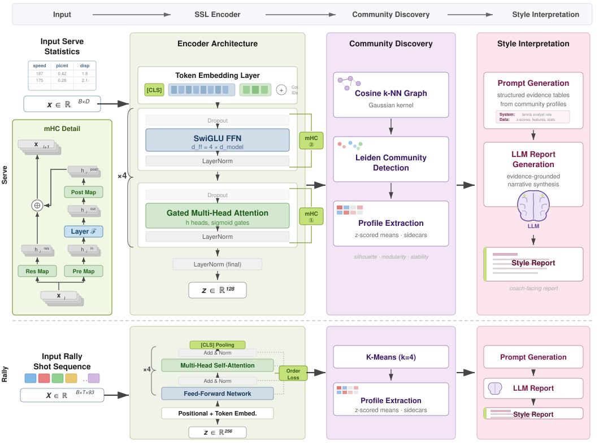
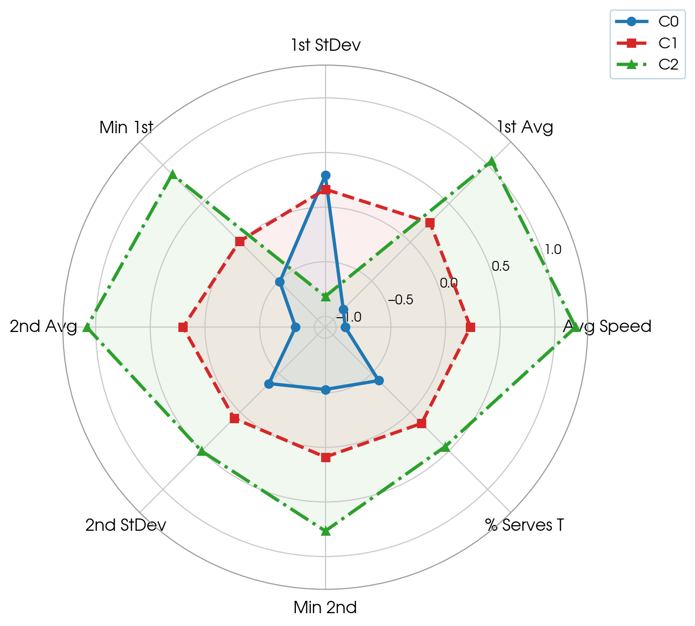
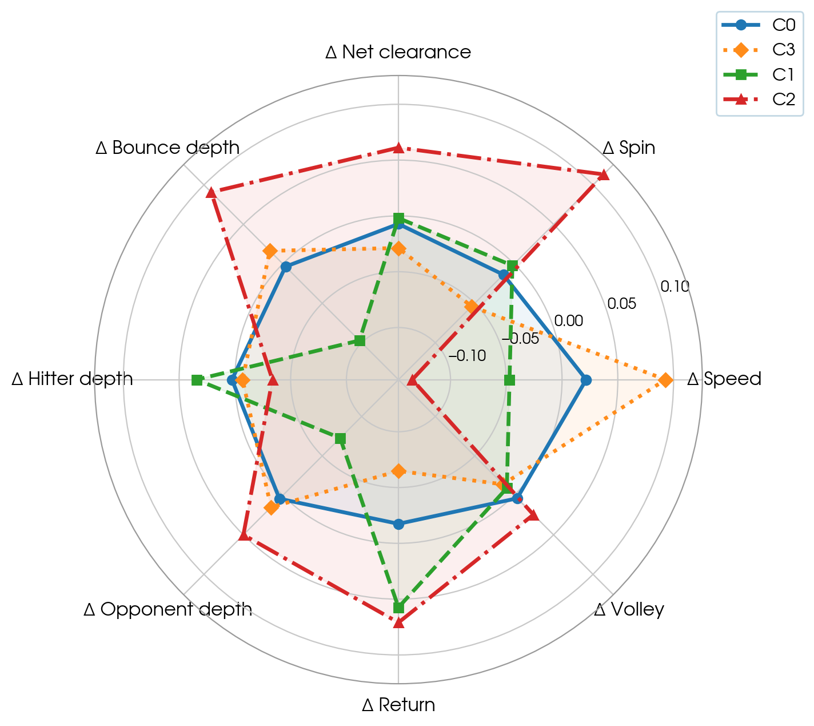
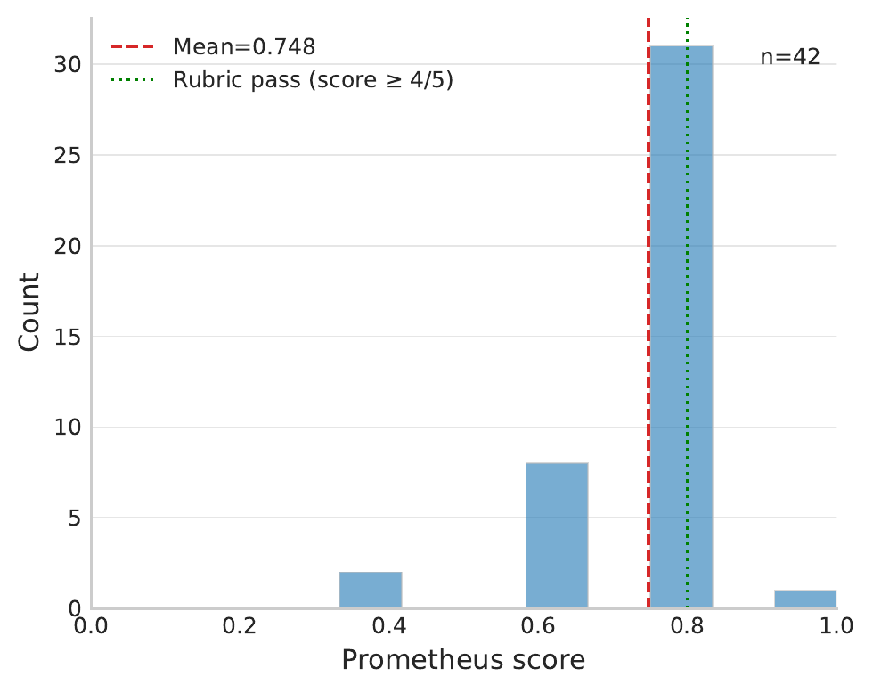
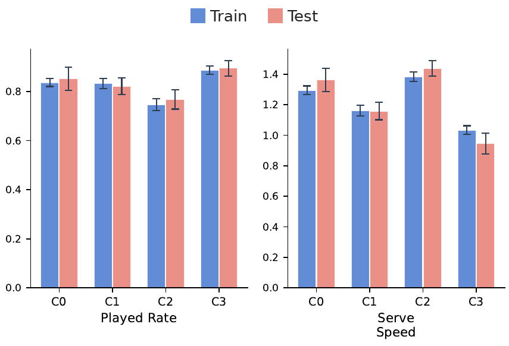

# CourtStyle

CourtStyle is a unified self-supervised framework for discovering recurring serve and rally styles from structured tennis match records, and for translating the discovered profiles into natural-language descriptions for practitioners. Serve records and rally records are encoded by modality-specific transformers trained without style labels, clustered into style groups, and characterised from their measured profiles.

This repository contains the reference implementation of the KES 2026 paper.

## Publication

**[CourtStyle: Unified Self-Supervised Framework for Tennis Playing Style Discovery](https://www.sciencedirect.com/browse/journals-and-books)**
Ahmed Jouini, Faten Chaieb-Chakchouk, Alex Loth

Presented at the 30th International Conference on Knowledge-Based and Intelligent Information & Engineering Systems (KES 2026). The proceedings are scheduled for publication in Elsevier's *Procedia Computer Science* and will be available through ScienceDirect.

> Publication metadata will be updated when the final *Procedia Computer Science* record and DOI become available.

## Overview

<p align="center">
  
</p>

Two structured record types pass through one four-stage pipeline of self-supervised encoding, style discovery and natural-language interpretation.

**Top row.** Fixed-length serve statistics are tokenised by column with learnable column identities, encoded by a four-layer tabular transformer with manifold-constrained hyper-connections and gated multi-head attention, and pooled into `z ∈ R^128`. A cosine k-nearest-neighbour graph weighted by a Gaussian kernel feeds Leiden community detection.

**Bottom row.** Rally shot-transition sequences `X ∈ R^(B×T×93)` receive positional and token embeddings, pass through four self-attention blocks trained under an additional order loss, and pool from `[CLS]` into `z ∈ R^256`. K-Means with `k=4` forms the rally styles.

Both branches then converge on profile extraction over z-scored means, prompt generation from structured evidence statements, and language-model report generation.

## Method

| Stage | Serve branch | Rally branch |
|---|---|---|
| Sample | one server–match record | one shot-transition sequence |
| Tokenisation | one token per column, no positional encoding | one token per shot transition, learned positional embedding |
| Encoder | mHC tabular transformer, `d_model=128`, 8 heads, depth 4 | pre-norm transformer, `d_model=256`, 4 heads, 4 layers |
| View generation | SCARF-style feature corruption, categoricals masked to an unknown token | crop, token dropout, feature masking, Gaussian noise, court-axis flips |
| Objective | symmetric MoCo v3 InfoNCE, `τ=0.101` | NT-Xent `τ=0.15` + order repulsion `λ=0.2`, `m=0.2` |
| Discovery | cosine k-NN graph (`k=15`) + Gaussian kernel + Leiden | K-Means, `k=4` |
| Interpretation | structured evidence statements → Qwen 2.5 32B → schema and citation validation | same |

Both encoders optimise an InfoNCE objective over two augmented views of each record, instantiated as MoCo v3 for serves and as NT-Xent with an order term for rallies. They share no parameters and no latent space.

## Repository structure

```
courtstyle/
├── data/
│   ├── serve_dataset.py            serve record preprocessing
│   ├── synthetic_serve.py          TVAE synthetic serve records for pre-training
│   ├── rally_dataset.py            rally shot preprocessing and match splits
│   └── rally_transitions.py        shot-transition tokens and rally sequences
├── models/
│   ├── serve_encoder.py            mHC tabular transformer
│   └── rally_encoder.py            pre-norm sequence transformer
├── training/
│   ├── contrastive.py              MoCo v3, NT-Xent and order-repulsion losses
│   ├── train_serve.py              two-stage serve training
│   └── train_rally.py              rally training
├── discovery/
│   ├── serve_discovery.py          k-NN graph and Leiden
│   └── rally_discovery.py          length residualisation and K-Means
├── interpretation/
│   ├── serve_interpretation.py     serve profiles and evidence statements
│   ├── serve_reports.py            validated serve reports
│   ├── rally_interpretation.py     rally fact pack and prompt
│   └── rally_reports.py            validated rally reports
└── evaluation/
    ├── serve_inference.py          held-out serve embedding and k-NN assignment
    ├── evaluate_serve_heldout.py   held-out serve assignment against expert annotations
    ├── evaluate_reports.py         Prometheus 2, MiniCheck and AlignScore report evaluation
    └── rally_transfer.py           held-out rally transfer
configs/     serve.yaml, rally.yaml
scripts/     run_serve.sh, run_rally.sh
assets/      framework figure and published result figures
docs/        data_format.md
```

## Installation

Verified against Python 3.12, PyTorch 2.4 with CUDA 12.1.

```bash
conda create -n courtstyle python=3.12
conda activate courtstyle
pip install -r requirements.txt
```

Leiden community detection requires `leidenalg` and `python-igraph`. Synthetic serve generation requires `sdv`. The interpretation and evaluation stages call locally hosted language models through [Ollama](https://ollama.com).

## Running the pipeline

Place the input files as described in [`docs/data_format.md`](docs/data_format.md), then run each branch from the repository root:

```bash
bash scripts/run_serve.sh
bash scripts/run_rally.sh
```

Each script runs the stages below in order. Every module can also be run on its own with `python -m <module> --help`.

| Stage | Serve branch | Rally branch |
|---|---|---|
| Preprocessing | `courtstyle.data.synthetic_serve`, `courtstyle.data.serve_dataset` | `courtstyle.data.rally_dataset` |
| Self-supervised encoding | `courtstyle.training.train_serve` | `courtstyle.training.train_rally` |
| Style discovery | `courtstyle.discovery.serve_discovery` | `courtstyle.discovery.rally_discovery` |
| Evidence statements | `courtstyle.interpretation.serve_interpretation` | `courtstyle.interpretation.rally_interpretation` |
| Report generation | `courtstyle.interpretation.serve_reports` | `courtstyle.interpretation.rally_reports` |
| Held-out evaluation | `courtstyle.evaluation.evaluate_serve_heldout`, `courtstyle.evaluation.evaluate_reports` | `courtstyle.evaluation.rally_transfer` |

Hyperparameters are read from `configs/serve.yaml` and `configs/rally.yaml`, which hold the configuration of the run reported in the paper. The style radar figures are written by the discovery stage, the report-evaluation histogram by `evaluate_reports`, and the transfer figure by `rally_transfer`.

## Data

CourtStyle uses two independent sources that share no surface, tournament, season, match or player.

**Serve records.** Public match statistics from [Tennis Abstract](https://www.tennisabstract.com/), covering the US Open and Wimbledon between 2016 and 2024. The Grand Slam point-by-point and ATP tour repositories used to assemble the records have since been withdrawn from public hosting and remain available through the [Software Heritage](https://archive.softwareheritage.org/) archive. One row of serve statistics per server and match is aggregated into one fixed-length record, and 41 raw columns are reduced to 29.

**Rally records.** Hawk-Eye ball-tracking logs from Roland-Garros 2021, supplied by the French Tennis Federation. **These data are not redistributable and are not included in this repository.** Each token carries 93 dimensions, from 31 raw shot variables represented as the current shot, the next shot and their difference. The expected column schema is documented in [`docs/data_format.md`](docs/data_format.md) so that equivalent tracking data can be used.

Coach-annotated reference notes used by the report evaluation are likewise not redistributable. `docs/data_format.md` gives the expected columns and a header template.

## Results

Style names are assigned by the interpretation stage. `C0`–`C3` are the cluster identifiers.

### Serve styles

| Community | Count | Style | Key serve profile | Key outcomes |
|---|---:|---|---|---|
| C0 | 484 | Low-pace Body-spread | Avg speed −0.92, Body share +0.35, Width var. +0.39 | Aces −0.45, 1st-serve pts won −0.16, Break pts faced +0.19, Break pts saved +0.10 |
| C1 | 514 | Mid-pace Wide-mix low-dispersion | Avg speed +0.23, Wide share +0.20, Width var. −0.24 | Aces +0.17, Double faults +0.06, 1st-serve pts won +0.03, Break pts faced −0.02, Break pts saved +0.00 |
| C2 | 275 | High-pace T-precision | Avg speed +1.19, 1st-serve speed var. −0.82, T share +0.45, Min 1st +0.88 | Aces +0.47, 1st-serve pts won +0.23, 2nd-serve pts won −0.19, Break pts faced −0.28, Break pts saved −0.19 |

<p align="center">
  
</p>

Style means as z-scores over the training records. Each axis is one serve variable, and zero is the population mean.

### Rally styles

| Community | Count | Style | Key rally profile | Key outcomes |
|---|---:|---|---|---|
| C0 | 1,809 | Mid-Entry Groundstroke | Groundstroke +0.07, Rally shot +0.07, Serve stroke −0.05, Shot duration −0.04 | Rally length +0.11, Duration +0.09, Played rate +0.02, Fault rate −0.00 |
| C1 | 1,261 | Mid-Entry High-Move | Response speed −0.13, Player distance Δ +0.09, Response duration +0.13, Opponent depth +0.09, Serve stroke +0.08 | Rally length −0.13, Duration −0.10, Break pts −0.06, Played rate +0.01 |
| C2 | 1,193 | Fast-Entry Decelerating | Shot speed +0.16, Backspin +0.19, Topspin −0.19, Serve stroke +0.12, Speed Δ −0.13, Spin rate Δ +0.11 | Fault rate +0.16, Played rate −0.22, Rally length −0.19, Duration −0.18 |
| C3 | 1,330 | Slow-Entry Extended | Topspin +0.14, Spin rate +0.13, Speed Δ +0.09, Response speed +0.09, Backspin −0.10, Serve stroke −0.07 | Played rate +0.16, Fault rate −0.15, Rally length +0.15, Duration +0.14, Break pts +0.08 |

<p align="center">
  
</p>

Style means as z-scores over the training rallies. Each axis is a transition-level change between consecutive shots, computed as the next shot minus the preceding one. `Δ` denotes such a transition-level feature.

### Report evaluation

<p align="center">
  
</p>

Prometheus 2 evaluates generated coach notes against coach-annotated reference notes on the 42 held-out serve instances, scoring semantic equivalence on a five-point rubric scoped to the evidence supplied to the generator. The mean normalised score is 0.748 and 32 of the 42 notes reach the rubric-pass threshold.

### Held-out style profile transfer

<p align="center">
  
</p>

Style means are compared between the training rallies and seven disjoint held-out matches, with error bars denoting bootstrap 95% confidence intervals. Train and test intervals overlap for every style on both metrics shown, and the ranking of the styles is preserved.

## Reproducibility

Each module was checked against the outputs of the run reported in the paper, using the same data:

* Preprocessing writes the same processed serve and rally files, up to floating-point rounding, and the same rally train/validation match split.
* The training code produces the same losses and weights as the implementation used for the paper, for the same data and seed.
* From the paper's encoder checkpoints, discovery gives the same style assignment for every serve record and every rally, including the held-out rallies. The evidence statements and report prompts are byte-identical.
* The held-out evaluations reproduce the reported serve assignment metrics, rally outcome association and transfer intervals. The report-evaluation scores are recomputed exactly from the model outputs stored by the paper run.

Three sources of variation remain when the pipeline is rerun from scratch. The TVAE synthetic generator is not seeded, so a regenerated synthetic set differs from the one used for pre-training in the paper. GPU kernels are not bit-deterministic, so retraining on different hardware or library versions can give slightly different weights. Language-model outputs can change across model builds even at temperature 0.

## Pretrained encoders

The encoders of the run reported in the paper are available on https://drive.google.com/drive/folders/1P4_ZrUCEjYIMYp8pdYmfM37kdZavU4sx?usp=sharing([DRIVE_URL_COURTSTYLE_FOLDER]), with SHA-256 checksums in `SHA256SUMS.txt`.

| File | Content | Place at |
|---|---|---|
| `serve/courtstyle_serve_encoder.pt` | serve encoder after stage 2, epoch 144 | `outputs/serve/serve_encoder_best.pt` |
| `serve/preprocessor.pkl` | imputation and standardisation fitted on the 1,018 training records | `data/serve/processed/preprocessor.pkl` |
| `rally/courtstyle_rally_encoder.pt` | rally encoder, epoch 195 (lowest validation loss) | `outputs/rally/models/best.pt` |

The serve checkpoint was selected by validation loss plus `0.1 × (1 − effective rank / 128)`. Its file is a loadable copy of the original checkpoint, whose archive had three training-curve images appended; every checkpoint entry is byte-identical to the original.

With the files in place, run the stages that follow training in `scripts/run_serve.sh` and `scripts/run_rally.sh`. On the paper's input data, discovery then reproduces the reported style of every serve record and every rally.

## Status

The released code covers the full pipeline of both branches, from preprocessing to held-out evaluation. The trained encoders of the paper run are listed in [Pretrained encoders](#pretrained-encoders).

## Citation

```bibtex
@inproceedings{jouini2026courtstyle,
  title     = {{CourtStyle}: Unified Self-Supervised Framework for Tennis Playing Style Discovery},
  author    = {Jouini, Ahmed and Chaieb-Chakchouk, Faten and Loth, Alex},
  booktitle = {Proceedings of the 30th International Conference on Knowledge-Based
               and Intelligent Information \& Engineering Systems (KES)},
  series    = {Procedia Computer Science},
  publisher = {Elsevier},
  year      = {2026},
  note      = {To appear}
}
```

Publication metadata will be updated when the final *Procedia Computer Science* record and DOI become available.

## Acknowledgements

Rally tracking data were supplied by the French Tennis Federation. The authors acknowledge the contribution of Farah Belhajammar and Neirez Cherni from the National Institute of Applied Science and Technology during their internship.

## License

The CourtStyle source code is released under the MIT License. See [`LICENSE`](LICENSE).

Third-party components are used as dependencies and are not redistributed here. `leidenalg` is GPL-3.0, `sdv` is under the Business Source License 1.1, and the language models invoked at inference time (Qwen 2.5, Prometheus 2) carry their own licences at their official sources.
